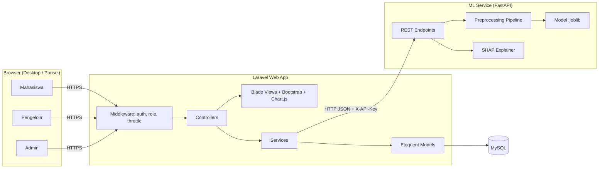
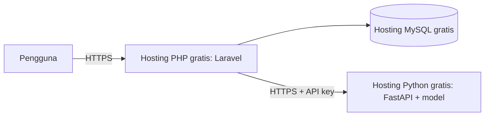

# Software Architecture Document (SAD)

> Proyek: DormInsight
> Dokumen: Fase 3 - System & Data Design
> Versi: 0.1 (Draft)
> Penyusun: Prayshe, Geraldo, Gerald
> Terakhir diperbarui: 23 November 2026

## 1. Tujuan

Dokumen ini menjelaskan arsitektur DormInsight: komponen sistem, tanggung jawab masing-masing, cara komponen berkomunikasi, dan keputusan desain utama. Dokumen ini menjadi acuan implementasi Fase 4 (ML) dan Fase 5 (aplikasi web).

## 2. Gaya Arsitektur

DormInsight memakai arsitektur **client-server berlapis dengan dua layanan terpisah**:

1. **Laravel Web App** (monolit MVC): antarmuka, logika bisnis, autentikasi, dan akses database.
2. **ML Service** (FastAPI): hanya melayani prediksi, explainability, dan simulasi. Tidak terhubung langsung ke database.

Alasan pemisahan:

- Model ML ditulis di Python, sedangkan aplikasi web di PHP.
- Tim web (Geraldo, Cheryl) dan tim ML (Gerald) dapat bekerja paralel dengan kontrak API yang jelas.
- Model dapat diganti atau dilatih ulang tanpa mengubah kode Laravel (NFR-051).
- Kegagalan ML service tidak menghentikan survei dan dashboard deskriptif (NFR-041).

## 3. Gambaran Arsitektur



## 4. Komponen dan Tanggung Jawab

### 4.1 Laravel Web App

| Lapisan | Isi | Tanggung Jawab |
|---|---|---|
| Routes + Middleware | `web.php`, `auth`, `role:admin\|pengelola\|mahasiswa`, `throttle:login` | Routing, autentikasi, otorisasi berbasis role, pembatasan percobaan login |
| Controllers | `AuthController`, `UserController`, `SurveyController`, `QuestionController`, `SubmissionController`, `ResponseController`, `AnalysisController`, `DashboardController`, `SimulationController`, `ReportController` | Menerima request dan mengembalikan view/response |
| Form Requests | Validasi per form | Validasi input di sisi server (NFR-003) |
| Services | `SubmissionService`, `FeatureBuilder`, `ResponseValidator`, `MlClient`, `AnalysisService`, `ReportService` | Logika bisnis yang tidak diletakkan di controller |
| Models | Eloquent untuk setiap tabel (lihat ERD) | Akses data |
| Views | Blade + Bootstrap 5 + Chart.js | Tampilan responsif |

Service penting:

| Service | Fungsi |
|---|---|
| `SubmissionService` | Menyimpan respons, jawaban, dan catatan submission dalam satu transaksi tanpa menautkan jawaban ke akun |
| `FeatureBuilder` | Menghitung skor faktor (rata-rata item Likert) dan menyusun JSON fitur |
| `ResponseValidator` | Menandai respons mencurigakan (jawaban seragam, durasi di bawah 120 detik) |
| `MlClient` | Klien HTTP ke ML service: timeout, retry 1 kali, penanganan error |
| `AnalysisService` | Menjalankan alur analisis lengkap dan menyimpan hasil secara atomik |
| `ReportService` | Membuat PDF (DomPDF) dan Excel (Laravel Excel) |

### 4.2 MySQL

Menyimpan seluruh data aplikasi: akun, survei, jawaban anonim, fitur ML, dan hasil analisis. Detail di [ERD.md](ERD.md) dan [Data_Dictionary.md](Data_Dictionary.md).

### 4.3 ML Service (FastAPI)

| Modul | Fungsi |
|---|---|
| `app/main.py` | Inisialisasi FastAPI, memuat model saat startup, seluruh endpoint |
| `app/security.py` | Validasi header `X-API-Key` |
| `app/schemas.py` | Skema request/response (Pydantic) |
| `app/model_store.py` | Memuat model, prediksi, dan SHAP |
| `app/settings.py` | Membaca konfigurasi dari `.env` |
| `models/` | File `model.joblib` (pipeline preprocessing + model) dan `model_meta.json` |
| `src/` | Script training offline (dipakai di Fase 4, tidak dipanggil oleh API) |

Model disimpan sebagai **satu objek scikit-learn Pipeline** (preprocessing + classifier). Dengan cara ini preprocessing saat training dan saat prediksi dijamin sama.

## 5. Alur Data Utama

### 5.1 Pengisian Survei

```
Mahasiswa -> Laravel (validasi) -> transaksi DB:
    responses (UUID, tanpa user_id)
    answers (jawaban per pertanyaan)
    response_features (skor faktor + target)
    survey_submissions (user_id, tanpa jawaban)
```

### 5.2 Analisis ML

```
Admin -> AnalysisService -> MlClient:
    GET  /health, /model/info   (cek model dan kecocokan fitur)
    POST /predict/batch         (probabilitas per respons)
    POST /explain/global        (SHAP per faktor)
-> transaksi DB: analysis_runs, analysis_predictions, analysis_shap
```

### 5.3 Dashboard

Dashboard membaca data agregat dari MySQL saja. ML service hanya dipanggil untuk fitur simulasi.

Diagram urutan lengkap ada di [UML/Sequence_Diagram.md](UML/Sequence_Diagram.md).

## 6. Arsitektur Keamanan dan Privasi

| Aspek | Desain | Requirement |
|---|---|---|
| Autentikasi | Session Laravel, password bcrypt | FR-001, NFR-002 |
| Otorisasi | Middleware `role` per grup route | FR-004, NFR-001 |
| Brute force | Rate limiter login: 5 percobaan per menit per akun dan IP | NFR-005 |
| CSRF, XSS, SQL injection | Token CSRF bawaan Laravel, escaping Blade, Eloquent/query binding | NFR-003 |
| Anonimitas jawaban | `responses` memakai UUID acak dan tidak menyimpan `user_id`; tanggal tanpa jam; `answers` tanpa ID auto-increment | NFR-010, NFR-011 |
| Segmen kecil | Statistik segmen dengan kurang dari 5 responden disembunyikan | FR-065 |
| Laravel ke ML | API key di `.env` kedua layanan; ML service tidak dapat diakses tanpa key | NFR-004 |
| Transport | HTTPS pada hosting | NFR-006 |

**Mengapa UUID dan tanggal tanpa jam?** Jika `responses` memakai ID berurutan atau waktu kirim yang presisi, urutannya bisa dicocokkan dengan `survey_submissions` sehingga jawaban dapat ditebak pemiliknya. UUID acak dan tanggal saja memutus hubungan tersebut.

## 7. Arsitektur Deployment (Demo)



| Komponen | Kebutuhan |
|---|---|
| Laravel | PHP 8.2+, Composer, ekstensi `pdo_mysql`, `mbstring`, `gd` (untuk PDF) |
| MySQL | MySQL 8 atau MariaDB yang kompatibel |
| FastAPI | Python 3.10+, `requirements.txt`, RAM cukup untuk scikit-learn dan SHAP |

Catatan: layanan gratis dapat "tidur" saat tidak digunakan. `MlClient` memakai timeout 60 detik untuk panggilan pertama agar tidak gagal saat ML service sedang bangun. Penyedia hosting dipilih di Fase 7.

## 8. Lingkungan Pengembangan

| Komponen | Lokal |
|---|---|
| Laravel | `php artisan serve` di `http://localhost:8000` |
| MySQL | XAMPP/Laragon atau MySQL Server |
| FastAPI | `uvicorn app.main:app --reload --port 8001` |
| Editor | VS Code |
| Version control | Git + GitHub (branch `main`, `develop`, `feature/*`) |

## 9. Struktur Repository

```
DormInsight/
├── web-app/            Aplikasi web Laravel lengkap: tampilan Blade, controller, service, database
│   ├── app/Http/Controllers/
│   ├── app/Services/
│   ├── app/Models/
│   ├── database/migrations/
│   └── resources/views/
├── design/             Aset desain UI/UX: wireframe, ekspor Figma, screenshot
├── database/           Dump SQL, seeder data dummy, skrip backup
├── ml-service/
│   ├── app/            FastAPI
│   ├── src/            Training dan evaluasi
│   ├── notebooks/      EDA dan eksperimen
│   ├── models/         model.joblib, model_meta.json
│   └── data/           raw/, processed/ (tidak di-commit)
└── docs/
```

Catatan: karena Blade adalah bagian dari Laravel, kode tampilan (frontend) dan logika server (backend) berada dalam satu aplikasi di `web-app/`; kode tampilan ada di `web-app/resources/views/`. Folder `design/` hanya berisi aset desain dan tidak di-deploy. Nama folder diubah dari `backend/` dan `frontend/` pada 25 November 2026 agar sesuai isinya.

## 10. Keputusan Desain (Architecture Decision Record Ringkas)

| No | Keputusan | Alternatif | Alasan |
|---|---|---|---|
| ADR-01 | ML service terpisah (FastAPI) | Menjalankan Python dari Laravel via `exec` | Lebih aman, mudah diuji, dapat di-deploy terpisah |
| ADR-02 | ML service tidak mengakses database | ML membaca MySQL langsung | Satu sumber kebenaran data dan aturan privasi tetap di Laravel |
| ADR-03 | Model disimpan sebagai sklearn Pipeline | Preprocessing manual di API | Mencegah perbedaan preprocessing saat training dan prediksi |
| ADR-04 | Prediksi dijalankan per batch saat survei ditutup | Prediksi real-time setiap kali survei dikirim | Analisis bersifat agregat; lebih hemat sumber daya hosting gratis |
| ADR-05 | Fitur disimpan sebagai JSON di `response_features` | Satu kolom per faktor | Faktor dapat berubah antarperiode tanpa migrasi |
| ADR-06 | Blade + Bootstrap, bukan SPA | React/Vue | Lebih sederhana untuk tim dan waktu yang tersedia |
