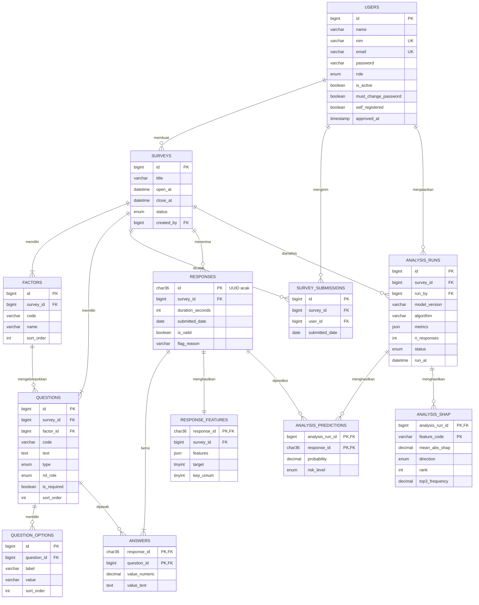

# Entity Relationship Diagram (ERD)

> Proyek: DormInsight
> Dokumen: Fase 3 - System & Data Design
> Versi: 0.1 (Draft)
> Penyusun: Geraldo (Backend Developer)
> Terakhir diperbarui: 23 November 2026

Diagram ditulis dalam Mermaid. Untuk melihatnya di VS Code, pasang ekstensi **Markdown Preview Mermaid Support**, lalu buka preview (`Ctrl+Shift+V`). GitHub juga merender Mermaid secara otomatis.

## 1. Diagram

## 2. Penjelasan Relasi

| Relasi | Kardinalitas | Keterangan |
|---|---|---|
| users - surveys | 1 : N | Admin pembuat survei |
| users - survey_submissions | 1 : N | Satu mahasiswa satu submission per survei (unique `survey_id, user_id`) |
| surveys - factors | 1 : N | Faktor milik satu survei |
| surveys - questions | 1 : N | Pertanyaan milik satu survei |
| factors - questions | 1 : N (opsional) | Pertanyaan non-faktor (angkatan, target, saran) memiliki `factor_id` NULL |
| questions - question_options | 1 : N | Opsi untuk jenis `single_choice` |
| surveys - responses | 1 : N | Respons anonim |
| responses - answers | 1 : N | Satu baris per pertanyaan yang dijawab |
| responses - response_features | 1 : 1 | Fitur siap ML hasil `FeatureBuilder` |
| analysis_runs - analysis_predictions | 1 : N | Probabilitas per respons untuk satu kali analisis |
| analysis_runs - analysis_shap | 1 : N | Satu baris per fitur |

## 3. Desain Anonimitas

**Tidak ada relasi antara `users` dan `responses`.** Satu-satunya hubungan mahasiswa dengan survei adalah tabel `survey_submissions`, yang hanya mencatat bahwa mahasiswa sudah mengisi.

| Teknik | Tujuan |
|---|---|
| `responses.id` berupa UUID acak | Urutan respons tidak bisa dicocokkan dengan urutan `survey_submissions.id` |
| Hanya tanggal (`DATE`), tanpa jam, di kedua tabel | Waktu kirim tidak bisa dicocokkan |
| `answers` memakai primary key gabungan, tanpa ID auto-increment | Urutan penyimpanan jawaban tidak terekam |
| Model `Response` menonaktifkan `timestamps` Laravel | Mencegah kolom `created_at` yang presisi |

## 4. Perubahan dari SRS

| SRS | ERD | Alasan |
|---|---|---|
| `responses.started_at`, `submitted_at` | `duration_seconds`, `submitted_date` | Mencegah pencocokan waktu (anonimitas); durasi tetap tersedia untuk deteksi respons asal-asalan |
| `survey_submissions.submitted_at` | `submitted_date` | Alasan yang sama |
| `answers.id` | Primary key gabungan `(response_id, question_id)` | Alasan yang sama |
| `response_features` dengan kolom per faktor | Kolom `features` JSON | Faktor dapat berubah antarperiode (ADR-05) |
| `questions.is_target` | `questions.ml_role` | Satu kolom menjelaskan peran pertanyaan dalam ML: item faktor, fitur, target, deskriptif, atau terbuka |

## 5. Tabel Bawaan Laravel

Tabel `sessions`, `password_reset_tokens`, `cache`, `cache_locks`, `jobs`, dan `failed_jobs` dibuat oleh migrasi bawaan Laravel dan tidak digambarkan di diagram.
