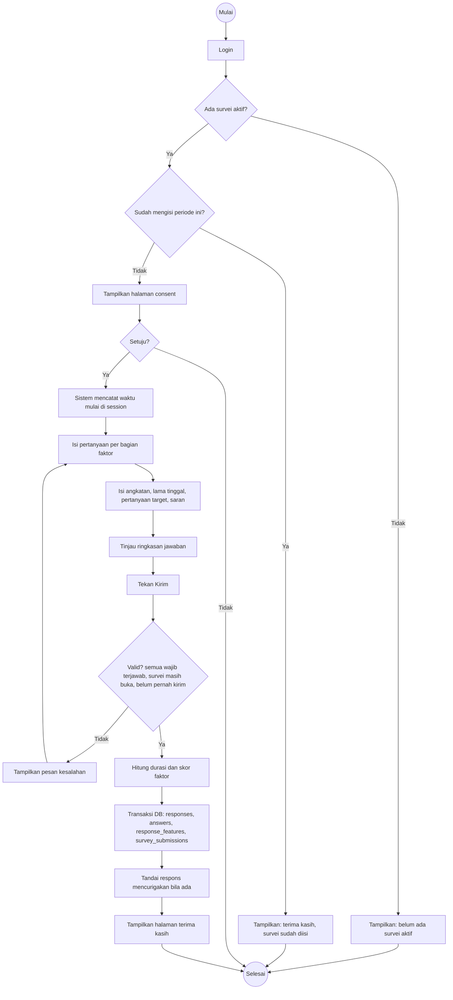
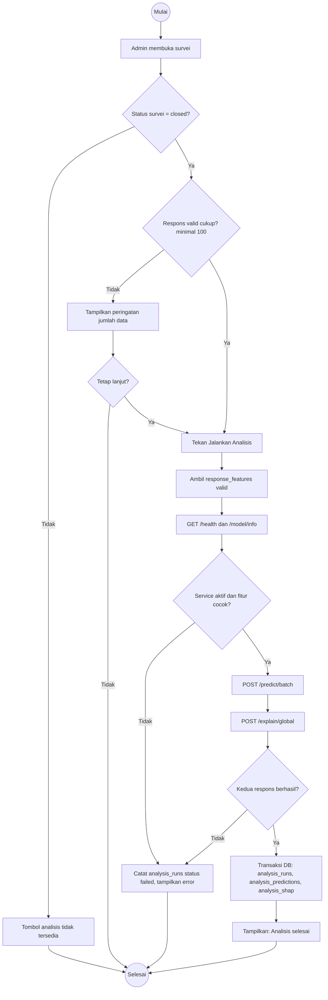
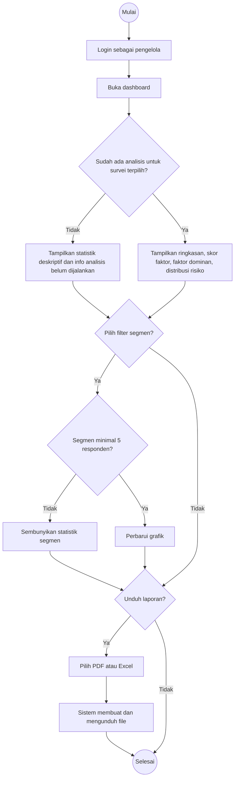

# Activity Diagram

> Proyek: DormInsight | Fase 3 | Versi 0.1 | Penyusun: Prayshe

## AD-01 Mengisi Survei (Mahasiswa)

## AD-02 Menjalankan Analisis ML (Admin)

## AD-03 Melihat Dashboard dan Mengunduh Laporan (Pengelola)

