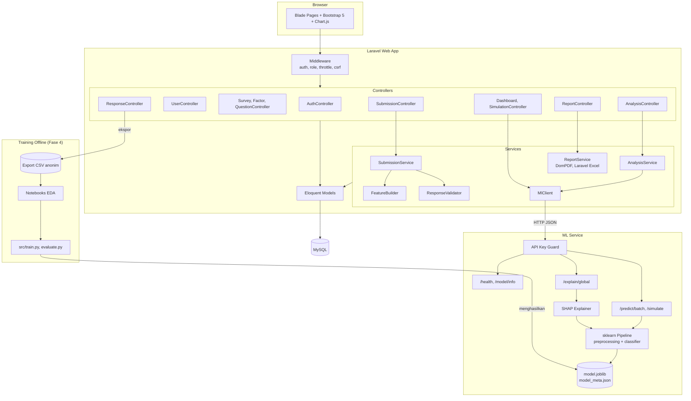

# Component Diagram

> Proyek: DormInsight | Fase 3 | Versi 0.1 | Penyusun: Geraldo, Gerald

## Keterangan Antarmuka

| Dari | Ke | Antarmuka |
|---|---|---|
| Browser | Laravel | HTTPS, form HTML, session cookie |
| Laravel | MySQL | PDO via Eloquent |
| Laravel (MlClient) | ML Service | REST JSON + header `X-API-Key` (lihat API_Documentation.md) |
| Training offline | ML Service | File `model.joblib` dan `model_meta.json` disalin ke `ml-service/models/` |
| Laravel | Training offline | Ekspor CSV respons anonim |
