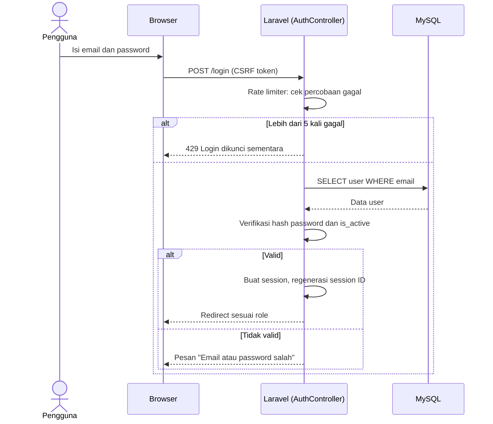
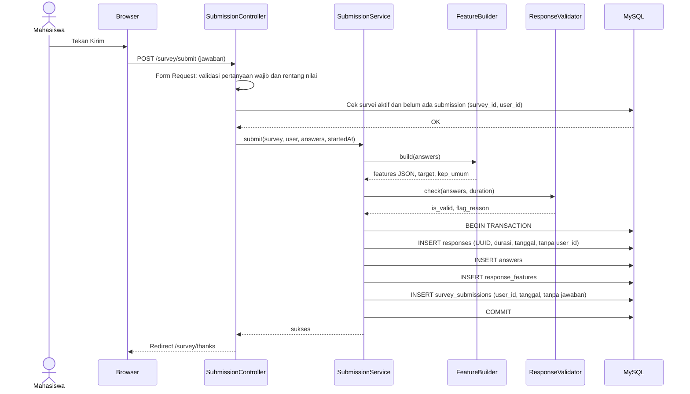
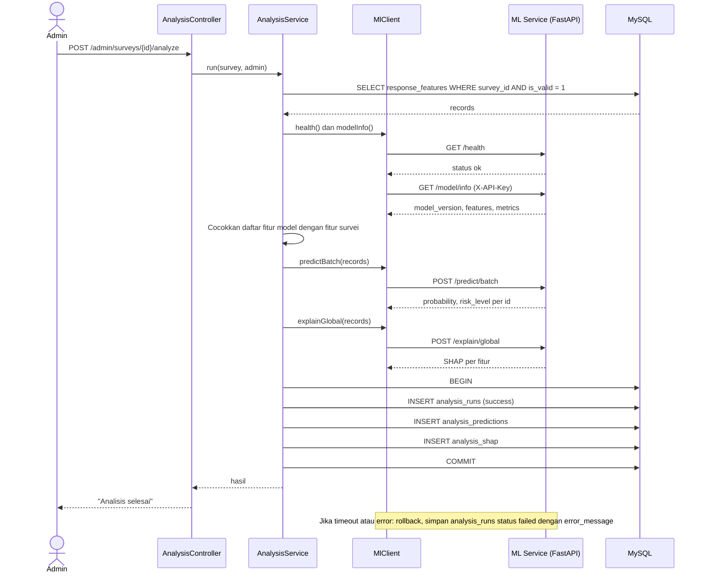
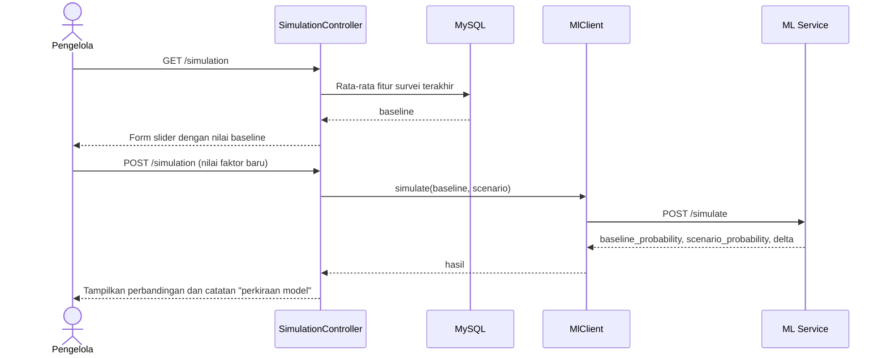

# Sequence Diagram

> Proyek: DormInsight | Fase 3 | Versi 0.1 | Penyusun: Geraldo, Gerald

## SD-01 Login

## SD-02 Mengirim Survei

Jika INSERT `survey_submissions` gagal karena unique constraint (misalnya dikirim dua kali dari tab berbeda), seluruh transaksi dibatalkan sehingga tidak ada respons ganda.

## SD-03 Menjalankan Analisis ML

## SD-04 Simulasi Skenario

