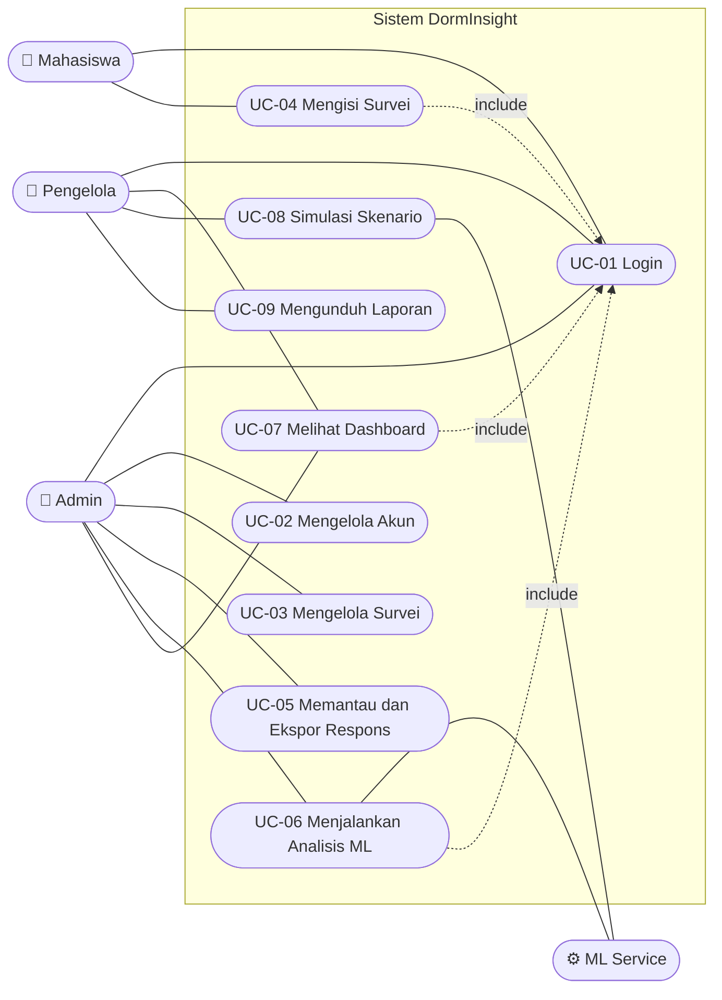

# Use Case Diagram

> Proyek: DormInsight | Fase 3 | Versi 0.1 | Penyusun: Prayshe

Mermaid belum memiliki notasi use case resmi, sehingga diagram digambarkan dengan flowchart: aktor di sisi kiri/kanan, use case berbentuk elips (stadium) di dalam batas sistem. Spesifikasi lengkap tiap use case ada di [Use_Case_Specification.md](../../02_Requirements/Use_Case_Specification.md).

## Keterangan

| Notasi | Arti |
|---|---|
| Garis tegas | Aktor berinteraksi dengan use case |
| Garis putus-putus `include` | Use case membutuhkan use case lain (harus login terlebih dahulu) |
| ML Service | Aktor sekunder (sistem eksternal) |

Admin juga dapat melihat dashboard karena memiliki seluruh hak akses Pengelola.

> Untuk laporan formal, diagram ini dapat digambar ulang dengan notasi UML standar di draw.io atau StarUML berdasarkan struktur yang sama.
